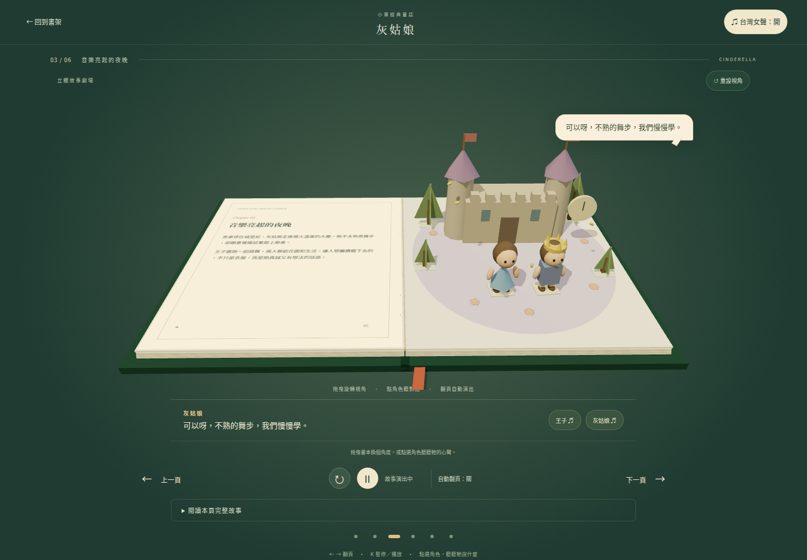

# 小葉故事屋

線上閱讀：**[小葉故事屋](https://erictsau.github.io/ele_book/)**，可直接透過瀏覽器開啟。

純靜態、繁體中文的互動電子書目錄。共 31 本完整故事、188 個場景與 381 段台灣女聲，包含 Three.js 立體書、可彎折書頁、立體人物與主題道具、角色對話與 GSAP 動作演出；書架使用自製 SVG 封面。

《三隻小豬》有 8 章；新增的《小紅帽》《龜兔賽跑》《醜小鴨》《傑克與魔豆》《金髮女孩與三隻熊》《糖果屋》《穿靴子的貓》《灰姑娘》《拇指姑娘》《獅子與老鼠》各有 6 章。內容為經典童話的兒童友善改寫，每本都有開端、發展與結局。

另外加入 **10 本公有領域經典改寫與 10 本原創故事**，各六章；書架可依系列篩選，閱讀器附新增經典的原作來源。完整書單及來源依據見 [故事來源與內容製作](STORY_SOURCES.md)。

## 專案特色

- 純 HTML、CSS 與 JavaScript，無後端服務或資料庫。
- Three.js 即時渲染立體書、人物和道具，GSAP 編排有限長度動畫。角色沿路線行走、轉身、搬材料、投石、送信、划船與合作，並改變水位、房屋、橋梁等道具狀態。
- 依劇情為 20 本書的 75 章建立室內或內外混合剖面：看得到房間地板、窗戶與家具，人物在其中演出。舞台延伸至整個雙頁，牆面保留淡淡的透明輪廓，靠近鏡頭的牆會更淡；人物、家具與地板保持不透明；進屋、逃出、窗外與屋內的角色各有空間界線。
- 桌面與手機版閱讀器，支援搜尋、收藏、章節選擇、字幕及減少動態效果。
- 配音預先產生並隨網站提供；閱讀時不連接語音服務。
- Web Audio 即時合成柔和背景音樂、風聲、水滴、腳步、敲擊、鳥鳴和翻頁聲，不使用外部音樂或音效素材。配音時自動降低背景音量。



## 開啟網站

不需要後端或建置。使用 Python 3 在專案根目錄執行：

```bash
python3 -m http.server 4186 --bind 127.0.0.1 --directory public
```

瀏覽 http://127.0.0.1:4186 。請使用 HTTP 伺服器，ES modules 不能直接透過 `file://` 開啟。

如已安裝 Node.js 22+：

```bash
npm ci
npm run dev
npm test
npm run test:e2e
npm run build
```

`dist/` 是可部署到任何靜態網站主機的產物。GSAP、Three.js、OrbitControls 放在 `public/vendor/`，配音放在 `public/audio/`，執行時不需要 CDN、帳號、API key 或外部字型。

## 閱讀操作

- 在書架搜尋書名、主題或收藏故事，共 31 本可閱讀。
- 點書本開始閱讀；左右按鈕、方向鍵、在非 3D 畫布區左右滑動都可以翻頁。
- 拖曳 3D 畫布旋轉視角；點「重設視角」回到預設鏡頭。場景有實際幾何厚度、光線、陰影與透視。
- 每次翻頁先收起舊場景、彎折立體書頁，再立起新場景並自動開始動畫；台灣女聲依該章事件時點播放，保留使用者的靜音選擇。
- 點畫中的角色或下方角色按鈕，顯示該角色的對話並做獨立手勢，不倒轉故事或改變道具狀態。
- 可暫停、重播、直接選章、自動翻頁。每頁使用 16 秒的分鏡時間軸；相鄰配音尚未說完時，動畫會在對話節點等待，因此實際播放時間可能較長。自動翻頁在演出結束後至少等待 3 秒，並等待配音結束；最後一章停下。
- 內建 381 段台灣女生配音（`zh-TW-HsiaoChenNeural`）。點開書本後播放，右上角可關閉。MP3 隨網站提供，不需要系統語音或執行時的雲端 TTS。音訊失敗仍可閱讀完整字幕。
- 「環境音」獨立控制背景音樂與劇情音效，不影響台灣女聲開關；首次開書後才啟用聲音。暫停、翻頁、切換分頁與關書均停止上一段聲音。
- 每本書分別在本機儲存閱讀位置與收藏；儲存被阻擋時仍能閱讀，不提供跨裝置同步。
- 支援 `prefers-reduced-motion`：停用翻頁／角色動畫與自動翻頁，直接顯示所有對話。
- 關閉書本、切換分頁或翻頁會停止舊場景與語音。按 Escape 關閉。

## 專案結構

- `public/index.html`、`styles.css`：目錄與閱讀器。
- `public/books.js`：31 本書的目錄、配色與音檔路徑。
- `public/story.js`、`fairytales.js`、`classics.js`、`originals.js`：完整故事、章節、角色對話與場景配置。
- `public/art.js`、`covers.js`：31 本書的 SVG 紙雕封面。
- `public/fairytale3d.js`：新增故事的立體人物、動物、主題道具與動作。
- `public/book3d.js`：真正的 3D 書頁、紙張厚度、彎曲翻頁、人物／房屋／樹木模型、燈光、鏡頭、角色點選。
- `public/story-motion.js`：行走步態、轉向與依動作類型編排的演出。
- `public/story-events.js`、`legacy-motion.js`、`original-motion.js`：依書本與章節編排的投石升水、樂隊疊高、送信與紙船航行等故事專屬場面。
- `public/soundscape.js`：原創合成背景音樂、環境音、劇情音效及配音降音量。
- `public/story-props.js`、`cover-emblems.js`：新增道具與封面圖案。
- `public/legacy-details.js`、`classic-motion.js`、`original-details.js`：每章道具起始狀態、實際接觸位置及事件結果。
- `public/stage-layout.js`：雙頁舞台與人物等比例放大；書面不再繪製左頁文字，完整故事保留於可展開的閱讀區。鏡頭按章節幾何及高處動作取景。
- `public/interiors.js`：逐章室內設定、房間剖面、透明牆處理與儲藏室開門動畫；小豬房屋剖面由 `book3d.js` 建立。
- `STORY_REVIEW.md`：全書逐本發現的劇情／動畫問題與修正。
- `public/app.js`：演出時間軸、翻頁、互動與語音。
- `public/state.js`：閱讀狀態與容錯。
- `DESIGN.md`：紙雕、奶油紙張、森林綠、陶土橘的視覺設計。

## Hyperframes 的使用範圍

採用了 Hyperframes skill 的動畫編排方式：所有 GSAP 時間軸同步建立為 `paused: true` 並註冊於 `window.__timelines`，每個場景 16 秒、僅使用有限次循環。依使用者後續要求，閱讀器已改由 Three.js 操作真實幾何物件，而非 Hyperframes 的 HTML 影片 composition。網頁閱讀器自行管理播放、對話、內建音檔和導覽。這不是 Hyperframes Studio，也沒有宣稱完成 CLI 驗證或影片輸出；未引入影片渲染工具，避免將互動繪本限制成影片。

## 驗證

`npm test` 共 50 項，包含故事目錄、獨立進度、書籤遷移、儲存容錯，以及三組逐書劇情語意測試：使用正式 Three.js 幾何與 GSAP 驗證跨線先後、投石入壺、開門救援、乘客同步、道具跨頁狀態與全部 180 個新增章節的重播。Playwright 共 52 項，包含 30 本六章故事逐章 WebGL 與 MP3 實際播放、進度／收藏隔離、背景音輸出與停止、手機版、減少動態效果、鏡頭／翻頁／互動、房屋施工及倒塌、點角色不倒轉劇情、相鄰配音不截斷，以及語音失效容錯。逐本修正與驗證邊界見 [全書檢查紀錄](STORY_REVIEW.md)。

E2E 預設使用此工作站 `/opt/google/chrome/chrome`。其他環境可設定 `CHROME_PATH` 指向 Chrome；未設定且系統路徑不存在時，使用 Playwright 安裝的 Chromium（先執行 `npx playwright install chromium`）。測試會自行啟動 4186 連接埠的靜態伺服器。

已在 Chromium 驗證 MP3 實際播放進度及關閉後停止；Safari／Firefox 與實體手機尚需在對應設備確認。3D 畫面需要 WebGL 2，無法初始化時會顯示提示並保留完整文字閱讀。手機驗證為 Chromium 裝置尺寸與觸控事件模擬。

## 重新產生台灣女生配音

已提供音檔，平常啟動與部署無須執行以下步驟。故事對話修改後，可在 Node.js 已加入 PATH 的環境重新產生：

```bash
python3 -m venv .venv
.venv/bin/pip install edge-tts==7.3.1
.venv/bin/python scripts/generate_audio.py
```

產生階段使用 Microsoft Edge 線上語音服務；只傳送故事資料模組內的對話，無使用者資料。角色全部使用台灣女性合成聲音 HsiaoChen。每本書音檔目錄的 `manifest.json` 記錄對話、檔名與聲音設定。腳本會跳過內容與設定一致且已存在的音檔，可中斷後重新執行。此工具不屬於網站執行時依賴。

## 部署

執行 `npm run build` 後，將 `dist/` 的全部內容放到靜態網站主機，保留 `audio/` 與 `vendor/` 等相對路徑。入口為 `index.html`，不需要伺服器端路由重寫。本儲存庫已設定 `.github/workflows/static.yml`，推送 `main` 後會將 `public/` 發布到 GitHub Pages；部署結果以 Actions 與實際網站讀回為準。

## License

本專案自有程式碼採用 **MIT License**，Copyright (c) 2026 EricTsau，完整條款見 [LICENSE](LICENSE)。

第三方元件保留各自授權，不因本專案採用 MIT 而改變：

- **Three.js 與 OrbitControls**：MIT，見 [THREE-LICENSE.txt](public/vendor/THREE-LICENSE.txt)。
- **GSAP 3.14.2**：依 [GSAP Standard License](https://gsap.com/standard-license)；原始檔頭與 [NOTICE.txt](public/vendor/NOTICE.txt) 保留版權及授權資訊。
- **合成配音**：以 Microsoft Edge 線上語音服務的 `zh-TW-HsiaoChenNeural` 產生，來源與設定記錄於各音檔目錄的 `manifest.json`；相關服務條款不由本專案 MIT License 取代。

故事為經典童話的兒童友善改寫，封面與場景由本專案以 SVG 和 Three.js 建立，未引用現代出版繪本的插圖或錄音。
